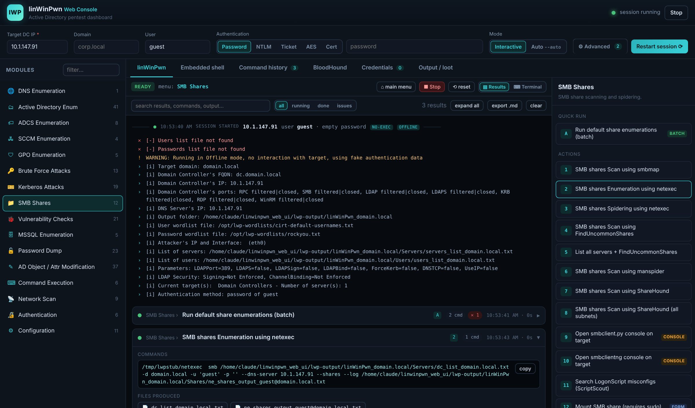

# linWinPwn Web Console

A web dashboard for [linWinPwn](https://github.com/lefayjey/linWinPwn). Every menu and every option of the script (16 menus, 238 actions) is a button, and there is a real embedded shell next to it.

Everything is done from the web: you pick menus and options with buttons, and every question the script asks is answered in a web form. The terminal only shows the output (typing in it is optional, behind the "type in terminal" checkbox).

The dashboard does not rewrite any linWinPwn logic. The backend starts the real `linWinPwn.sh` inside a pseudo terminal, the buttons send the same keys you would type, and the browser reads the output to know what the script is waiting for.



More screenshots in [docs/screenshots](docs/screenshots): [session bar](docs/screenshots/01_config_bar_advanced.png), [question form](docs/screenshots/02_results_question_waiting.png), [terminal view](docs/screenshots/04_terminal_view.png), [Auto mode](docs/screenshots/05_auto_mode_results.png), [BloodHound overview](docs/screenshots/06_bloodhound_overview.png), [BloodHound explorer](docs/screenshots/07_bloodhound_explorer.png), [findings + detail panel](docs/screenshots/08_bloodhound_findings_detail.png).

## Features

- **Session bar at the top, always visible**: target DC, domain, user, the 5 auth methods (password, NTLM hash, Kerberos ticket, AES key, PFX cert), the **mode** (Interactive or Auto `--auto`) and Start/Restart. Every other CLI flag (`-T`, `-I`, `-a`, DNS IP, LDAP port, wordlists, output dir, `--ldaps`, `--ldap-sign`, `--ldap-bind`, `--force-kerb`, `--use-ip`, `--dns-tcp`, `--auto-config`, `--verbose`, `--no-exec`, `--offline`) sits in the **⚙ Advanced** dropdown, with a badge counting what is set. Press Enter in any field to start. The form is remembered in the browser between reloads, passwords and keys excepted.
- **Two modes**:
  - *Interactive*: you drive linWinPwn from the module buttons.
  - *Auto (`--auto`)*: linWinPwn runs every default enumeration by itself; you follow it in the Results view.
- **Module sidebar**: all menus with a filter box. Each action has badges: `noisy`, `batch` (the `A` option of each menu), `form` (asks questions) and `console` (opens an interactive tool).
- **Two views of the output, your choice** (switch at the top right of the linWinPwn tab, remembered):
  - **▤ Results**: no terminal. Each action becomes a card: menu and action name, status (running, waiting for your answer, done, stopped), the commands it ran (with copy buttons), the output sorted into success / warning / error / info lines, the answers you gave in the forms, and the files it produced (click to open them in Output / loot). Menu listings are filtered out. In Auto mode the cards are named after what the script announces (`DC List Enumeration`, `Get MachineAccountQuota`...) and grouped by its sections. Search, status filter (running / done / issues), expand/collapse all, export to Markdown. Passwords and keys from your session are masked in cards and exports. Cards survive a page reload.
  - **⌨ Terminal**: the raw linWinPwn output (xterm.js, colours kept), with optional typing.
- **Web forms for every question**: the UI reads the output and shows the right form under it:
  - text question, with the default value shown and a "Use default" button
  - password / hash / key fields are masked (with a show button)
  - yes / no (`y/N`) and two-choice questions (`'RC4' or 'AES'`) become buttons
  - values listed above a question (for example your IPs) become clickable suggestions
  - numbered lists (Modify target(s), LDAPPER options...) become buttons, plus a free text field
  - `press ENTER to continue` becomes a "Continue" button
  - tool consoles (evil-winrm, smbclient, mssqlclient, LDAP console...) get a command field
- **Run state**: `ready` (at a menu, buttons active), `running…`, `waiting for your answer` (pulses; the tab pulses too if you look elsewhere). The UI reads the menu headers (`[AD Enum menu]`...) so it always knows which menu the script is in.
- **■ Stop**: works like Ctrl+C on the running command only. You stay in the same menu and the session keeps running. If the tool ignores the signal it is forced after 3 to 5 seconds. (A real Ctrl+C would kill linWinPwn itself, since the script has no handler for it.)
- **⟲ reset**: restarts the whole session with the same config, also after a page reload.
- **Offline preview with your creds**: tick `Offline` + `No-exec` and fill the credentials: the script prints the exact commands it would run with them, without touching any target.
- **Command history**: every command linWinPwn runs (already masked by the script), with copy buttons.
- **Embedded shell**: a separate bash in the repo folder, for manual commands (netexec, impacket, certipy...). It keeps running when you switch tabs.
- **Output / loot**: read-only browser of the output folder, with preview and download (binary files offered as download).
- **BloodHound tab**: load a collection and get an overview with charts, about 45 AD hygiene checks with the objects concerned and how to fix them, and an explorer of every object with a detail panel. Markdown and CSV exports. See the section below for what it does and does not do.
- Secrets (`-p`, `-H`, `-A`, `--cert-pass`) are hidden in the command line shown back in the UI.

## Run it

Put the `web_ui/` folder next to `linWinPwn.sh` (it already is in this repo), then:

```bash
./web_ui/run.sh
```

The first run creates a virtualenv and installs Flask. The script prints a URL with a random token:

```
http://127.0.0.1:8777/?token=<token>
```

Options: `./web_ui/run.sh --port 9000`, or set your own token with `LWP_WEB_TOKEN=mytoken ./web_ui/run.sh`.

### Docker

```bash
docker build -f web_ui/Dockerfile.webui -t linwinpwn-webui .
docker run --rm -it --net=host \
  -e LWP_WEB_TOKEN=change-me \
  -v "$(pwd)/lwp-output:/opt/linWinPwn/lwp-output" \
  linwinpwn-webui
# open http://127.0.0.1:8777/?token=change-me
```

## How a button works

Action buttons are active only when the script is back at a menu (`ready`). The UI knows the current menu from the script's own headers:

- Each click also opens a card in the Results view, closed as `done` once the script is back at a menu.
- Action in the menu you are already in: it sends only the action key (e.g. `1`).
- Action in another menu: it sends `back`, then the menu number, then the action key.
- **⌂ main menu** goes back to the main menu.

If you type in the terminal yourself, the UI still follows, since it reads the headers.

## BloodHound tab

Drop a collection on the tab (the zip linWinPwn produces, a folder of `*_users.json`, or a single json), or pick one it finds in your output folder. Reads bloodhound-python, SharpHound v3+ and CE output. Three views:

**Overview.** Users, computers (servers vs workstations), Domain Admins and privileged accounts, DCs, groups, OUs, GPOs, certificate templates and CAs. Charts of user last logon, user password age and computer last logon (by age bucket). Privileged group sizes, operating systems (obsolete ones in orange), domain controllers with their OS, domains, functional level and trusts. Every card opens the matching list in the Explorer.

**Findings.** About 45 hygiene checks, sorted by severity, each with why it matters, what to do, and the objects concerned. Search (also by object name) and severity filter. Covers:
- accounts: stale and never used, recently created, disabled, password never expires / not required / older than a year / never changed since creation, Kerberos pre-authentication disabled, user accounts used as services (SPN), passwords in readable attributes (`userPassword`, `unixUserPassword`...), credentials in descriptions, logon scripts, SID history, objects left in `CN=Users` / `CN=Computers`
- privileged accounts: group membership, admins used as services, inactive admins, old admin passwords, admins with a mailbox, admins not marked sensitive, disabled accounts still in admin groups, computers in admin groups, rights given through deep nesting (with the chain), orphaned `adminCount`, operator / Schema / Enterprise Admins not empty, built-in Administrator and Guest, krbtgt rotation
- machines: unsupported OS (DCs separately), Windows 10, no LAPS, unconstrained and constrained delegation, inactive computers, machine passwords not renewed
- domain: single DC, functional level, trusts without SID filtering, Pre-Windows 2000 Compatible Access with broad groups, default password policy and `ms-DS-MachineAccountQuota` (when the collector provides them), empty groups, GPOs linked nowhere
- certificate services: CA accepting a requester-supplied subject, templates where the requester picks the subject, templates usable for any purpose

**Explorer.** Every object of the collection in a table: Users, Computers, Groups, OUs, GPOs, certificate templates, CAs, domains. Search, sort by any column, filters (enabled, disabled, privileged, stale 90d+, flagged), pages of 50, CSV export of the current view. Click a row (or any object in a finding, or a DC in the Overview) to open its detail panel: the findings that concern it, a summary, direct groups and groups reached through nesting, members (for groups), where a GPO is linked, and every attribute collected. Groups and members are clickable, with a back button.

Export the whole report as Markdown (inventory, DCs, activity table, findings with full object lists) for a client report.

Uploads go to `lwp-output/_bh_uploads/` (hidden from Output / loot), are only ever parsed as JSON, and a failed upload is deleted; the last 10 are kept. Tested on a synthetic 42,000-object domain: under a second to analyse, a fraction of a second per Explorer query.

**Scope.** This tab inventories the directory and checks its hygiene. It does not compute attack paths or analyse ACLs between objects. For that, use BloodHound CE on the same collection.

## Security

This console runs offensive tooling and gives a full shell with the rights of the user who started it.

- It listens on `127.0.0.1` only by default. Keep it that way. To use it from another machine, use an SSH tunnel (`ssh -L 8777:127.0.0.1:8777 kali`) instead of `--host 0.0.0.0`.
- Always keep a token (`run.sh` makes one for you). Every API call and websocket checks it.
- Use it only on engagements where you have written authorization.

## Files

| File | Role |
|---|---|
| `server.py` | Flask backend: PTY manager, websockets, session API, loot browser |
| `menus.json` | Menu tree shown in the sidebar (mirrors `MENUS.md`) |
| `bh_inventory.py` | BloodHound parser + AD hygiene checks (standard library only) |
| `static/` | Dashboard (HTML/CSS/JS) and vendored xterm.js 5.5 (works offline) |
| `run.sh` | Launcher (venv + token) |
| `tests/check_menus.py` | Checks `menus.json` against the script |
| `tests/test_bh_inventory.py` | Tests the hygiene checks on a synthetic collection |
| `Dockerfile.webui` | Image with all linWinPwn tools plus the web UI |

When linWinPwn adds new menu options, add them to `menus.json` (key + label), then run:

```bash
python3 web_ui/tests/check_menus.py
```

It checks every button against the script's menus (reads the script only, runs nothing) and lists options missing from the dashboard.

The BloodHound inventory has its own tests (75 assertions on a synthetic collection that triggers every check; no network, no AD):

```bash
python3 web_ui/tests/test_bh_inventory.py
```
